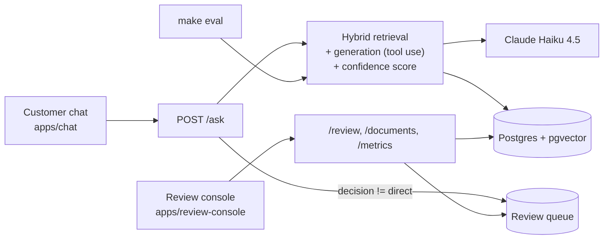

# TecnoAndes Assist

A customer-support RAG for a fictional Colombian tech retailer, built
around one thing most RAG demos skip: **an explicit confidence system
that decides, per response, whether to answer directly, answer with a
warning, or hand the case to a human** — plus a real review console
where that human resolves the case, fixes the knowledge base, and
re-tests the answer without leaving the app.

## The problem

A support bot that "always answers with the same tone of certainty" is
risky: if it can't tell "I know this for sure" from "I'm guessing," it
will eventually invent a price, a return window, or promise something
the real policy doesn't cover. The usual fixes are either "put a human
in the loop for everything" (kills efficiency) or "just trust the model"
(the source of the problem in the first place).

## The solution

Every question goes through hybrid retrieval (vector + full-text) and
generation with Claude, and the system computes its **own confidence
score** — it never asks the model how sure it is; it calculates that on
the system side from measurable signals (how well retrieval matched, the
model's own report of whether its answer is supported by the retrieved
context, whether it cited something that wasn't actually there). That
produces four possible routes:

- **`direct`** — the answer is shown as-is.
- **`warn`** — shown, but with a visible warning.
- **`review`** — the model's answer is *not* shown; the customer sees a
  generic fallback message and the case drops into the review queue.
- **`escalate`** — complaints, order/payment problems, or when the
  customer explicitly asks for a human. A hard rule, independent of the
  score.

The review console (`apps/review-console`) is where a human resolves
those cases: approve, correct the answer, correct *and* edit the
knowledge base (with a diff view), escalate, or discard — and re-run the
question against the corrected knowledge base, before/after, without
leaving the app.

## Architecture



See [`docs/ARCHITECTURE.md`](docs/ARCHITECTURE.md) for the full diagram
(step-by-step pipeline) and the [ADRs](docs/adr/) for the reasoning
behind each structural decision. [`docs/APRENDIZAJE.md`](docs/APRENDIZAJE.md)
(in Spanish) maps every RAG concept to the exact file it's implemented
in.

## Stack

Backend in Python 3.12 (synchronous FastAPI, SQLAlchemy 2 + Alembic,
Postgres + pgvector), local E5 embeddings (no cost, no API key),
generation with Claude Haiku 4.5 via forced tool use, and two Next.js
frontends (chat + console) in a pnpm monorepo with TypeScript types
generated straight from the backend's OpenAPI schema. No LangChain or
LlamaIndex — the RAG pipeline is hand-written on purpose, because the
point of this project is to demonstrate understanding of every piece,
not to wire together a black box. Full detail in [`CLAUDE.md`](CLAUDE.md)
(project instructions and every design decision, in Spanish).

## Quickstart

```bash
cp .env.example .env        # fill in ANTHROPIC_API_KEY and the passwords
make up                      # Postgres + backend in Docker, syncs the local venv
make migrate                 # applies Alembic migrations
make ingest                  # processes knowledge_base/*.md into chunks + embeddings
make search q="is there a store in Cali?"   # retrieval only, no LLM
make chat                    # customer chat at localhost:3000
make review-console          # review console at localhost:3001
make seed-demo                # (optional) loads varied example cases into the queue
make eval                    # runs eval/seed.jsonl against the real pipeline (needs an API key)
```

`make test` and `make lint` run without `ANTHROPIC_API_KEY` or internet
access — integration tests mock the Anthropic client; this is what runs
in CI ([`.github/workflows/ci.yml`](.github/workflows/ci.yml)). `make eval`
and `make seed-demo` do call the real API, and `make eval` asks for
confirmation with an estimated cost before spending anything (the real
cost is marginal — a few cents for the 28 seed cases).

Without `ANTHROPIC_API_KEY` configured, `/ask` still responds `200`
(never a raw technical error): the decision falls back to `review` with
a generic message, exactly as it would if the Anthropic API failed in
production — and that case automatically lands in the queue.

## What each app does

**The chat (`apps/chat`, `localhost:3000`)** has a "transparent mode"
toggle that shows, for every answer, the retrieved chunks with their
three scores (vector, full-text, RRF), the confidence signals, the
score calculated signal-by-signal, and which routing rule fired — built
so a demo explains itself.

**The review console (`apps/review-console`, `localhost:3001`, the
project's centerpiece)** offers: a queue with filters (status, reason,
confidence) and keyboard shortcuts, a case view with the full signal
breakdown, six reviewer actions, re-testing an already-resolved case
(before/after), a knowledge-base editor with version history, a
"knowledge gaps" view that clusters unsupported questions by similarity,
and a dashboard with decision distribution, accumulated cost/latency,
and the history of `make eval` runs.

## Retrieval: not just top-k similarity

Hybrid search (vector + full-text, fused with Reciprocal Rank Fusion —
see [ADR 0001](docs/adr/0001-hybrid-retrieval-raw-sql-rrf.md)) also does
**parent-document merging**: if one document clearly dominates the top
retrieval candidates (a broad question like "what phones do you have?"),
the system returns that *entire* document instead of a handful of
scattered fragments, so a category with a dozen products doesn't get
truncated to whatever fits in `top_k`. A simple candidate *count* isn't
enough to detect this reliably — products in the same category are
similar enough in text that even a specific question ("how much is the
iPhone 13?") pulls in 3-4 sibling products among the top candidates.
What actually separates a specific question from a broad one, measured
empirically, is whether one document takes a **clear majority** (>70%)
of the top candidates, not just a plurality. Specific questions keep
costing exactly what they cost before; only genuinely broad questions
pay for the larger context. Documented in decision 27 of
[`CLAUDE.md`](CLAUDE.md).

## Evaluation

`make eval` runs the 28 cases in [`eval/seed.jsonl`](eval/seed.jsonl)
against the real pipeline (retrieval + generation + routing, no mocks)
and measures three things per case: `recall@k` against the expected
documents, whether routing correctly escalated (or correctly did *not*
escalate) a complaint, and an LLM judge's verdict on whether the answer
matches the expected one — see
[ADR 0004](docs/adr/0004-llm-as-judge-evaluation.md). It's how the
confidence weights and thresholds in `.env` get calibrated with data
instead of by guessing.

This README doesn't include numbers from an actual run because this
repo wasn't built with a real `ANTHROPIC_API_KEY` configured in every
environment it passed through — run `make eval` yourself and the
results land in the console's dashboard (`/dashboard`), with the real
cost and latency of that run, not precomputed numbers.

## Demo script

[`docs/DEMO.md`](docs/DEMO.md) (in Spanish) walks through a ~6-minute
demo: a direct answer, a gray-area case (partial support), an
unsupported question plus a complaint that escalates, resolving a case
from the console by creating a new document, and confirming the chat
already uses it.

## Known limitations

- The confidence score is a calibratable heuristic, not a statistically
  validated measure — its weights and thresholds start from a
  reasonable initial guess and get tuned with `make eval`, not a formal
  calibration study.
- The console's auth is a single shared token, deliberately simple for
  a single-reviewer demo — not production-ready as-is (see
  [ADR 0005](docs/adr/0005-single-token-auth-review-console.md)).
- The LLM judge in `make eval` can be wrong — it's another model, not an
  oracle; it's meant to catch regressions and guide calibration, not to
  serve as a final approval without human judgment.
- The confidence breakdown a reviewer sees in the console is recomputed
  with the CURRENT weights in `.env`, not the ones in effect when the
  case was created (see decision 18 in `CLAUDE.md`).
- Retrieval's parent-document merge (see above) is a heuristic tuned
  empirically against this project's catalog size — it may need
  re-tuning for a knowledge base with very different characteristics
  (much larger categories, very different chunk sizes).

## Project documentation

Most of the project's internal documentation — `CLAUDE.md` (conventions
and every numbered design decision), `docs/ARCHITECTURE.md`,
`docs/APRENDIZAJE.md` (concept-to-file learning map), `docs/DEMO.md`,
and the [ADRs](docs/adr/) — is written in Spanish, since this project
was built with a Spanish-speaking collaborator end-to-end and the
in-app UI is Spanish-facing (a Colombian retailer's customers and staff
would expect that). This README is in English so the project is
approachable on GitHub regardless of that.
