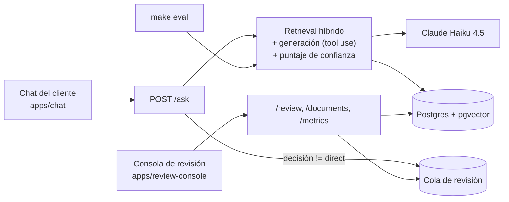

# TecnoAndes Assist

Un RAG de atención al cliente para una tienda de tecnología colombiana
ficticia, con un ingrediente que la mayoría de las demos de RAG no tiene:
**un sistema de confianza explícito que decide, por cada respuesta, si se
muestra directo, con advertencia, o se manda a un humano** — y una consola
de revisión de verdad para que ese humano resuelva el caso, corrija la
base de conocimiento, y vuelva a probar la respuesta sin salir de la app.

## El problema

Un bot de atención al cliente que "siempre contesta con el mismo tono de
seguridad" es riesgoso: si no distingue entre "esto lo sé con certeza" y
"esto lo estoy adivinando", tarde o temprano inventa un precio, un plazo
de devolución, o promete algo que la política real no cubre. La respuesta
típica es "agregar un humano en el loop en todos los casos", lo cual mata
la eficiencia, o "confiar siempre en el modelo", lo cual es la fuente del
problema.

## La solución

Cada pregunta pasa por retrieval híbrido (vectorial + texto completo) y
generación con Claude, y el sistema calcula un **puntaje de confianza
propio** — no le pregunta al modelo qué tan seguro está, lo calcula del
lado del sistema a partir de señales medibles (qué tan bien encajó el
retrieval, si el modelo reporta que su propia respuesta está respaldada
por el contexto, si citó algo que no estaba ahí). Con eso, cuatro rutas
posibles:

- **`direct`** — se muestra la respuesta tal cual.
- **`warn`** — se muestra, pero con una advertencia visible.
- **`review`** — no se muestra la respuesta del modelo; el cliente ve un
  mensaje de respaldo y el caso cae en la cola de revisión.
- **`escalate`** — reclamos, problemas de pedido/pago, o cuando el cliente
  pide un humano directamente. Regla dura, no depende del puntaje.

La consola de revisión (`apps/review-console`) es donde un humano resuelve
esos casos: aprobar, corregir la respuesta, corregir *y* editar la base de
conocimiento (con vista de diferencias), escalar, o descartar — y volver a
probar la pregunta contra la base ya corregida, antes/después, sin salir
de la app.

## Arquitectura



Ver [`docs/ARCHITECTURE.md`](docs/ARCHITECTURE.md) para el diagrama
completo (con el pipeline paso a paso) y los [ADRs](docs/adr/) con el
porqué de cada decisión estructural. [`docs/APRENDIZAJE.md`](docs/APRENDIZAJE.md)
mapea cada concepto de RAG al archivo exacto donde está implementado.

## Stack

Backend en Python 3.12 (FastAPI síncrono, SQLAlchemy 2 + Alembic,
Postgres + pgvector), embeddings E5 locales (sin costo ni API key),
generación con Claude Haiku 4.5 vía tool use forzado, y dos frontends
Next.js (chat + consola) en un monorepo pnpm con tipos TypeScript
generados del OpenAPI del backend. Sin LangChain ni LlamaIndex — el
pipeline de RAG está escrito a mano, a propósito, porque el objetivo del
proyecto es demostrar que se entiende cada pieza, no ensamblar una caja
negra. Detalle completo en [`CLAUDE.md`](CLAUDE.md).

## Quickstart

```bash
cp .env.example .env        # completa ANTHROPIC_API_KEY y las contraseñas
make up                      # levanta Postgres + backend, sincroniza el venv local
make migrate                 # aplica migraciones
make ingest                  # procesa knowledge_base/*.md a chunks + embeddings
make search q="hay sede en Cali?"   # solo retrieval, sin LLM
make chat                    # chat del cliente en localhost:3000
make review-console          # consola del revisor en localhost:3001
make seed-demo                # (opcional) carga casos de ejemplo variados en la cola
make eval                    # corre eval/seed.jsonl contra el pipeline real (necesita API key)
```

`make test` y `make lint` corren sin `ANTHROPIC_API_KEY` ni internet — los
tests de integración simulan el cliente de Anthropic; es lo que corre en
CI ([`.github/workflows/ci.yml`](.github/workflows/ci.yml)). `make eval` y
`make seed-demo` sí llaman a la API de verdad, y `make eval` pide
confirmación con un costo estimado antes de gastar (el costo real es
marginal — unos centavos de dólar por los 25 casos del set semilla).

Sin `ANTHROPIC_API_KEY` configurada, `/ask` sigue respondiendo `200`
(nunca un error técnico crudo): la decisión cae a `review` con un mensaje
de respaldo, tal como pasaría si la API de Anthropic fallara en
producción — y ese caso queda automáticamente en la cola.

## Lo que hace cada app

**El chat (`apps/chat`, `localhost:3000`)** tiene "modo transparente": un
interruptor que muestra, por cada respuesta, los chunks recuperados con
sus tres puntajes (vector, texto completo, RRF), las señales de confianza,
el cálculo del puntaje señal por señal, y la regla de enrutamiento que se
aplicó — pensado para que una demo se explique sola.

**La consola de revisión (`apps/review-console`, `localhost:3001`, la
"estrella" del proyecto)** ofrece: cola de casos con filtros (estado,
motivo, confianza) y atajos de teclado, detalle de cada caso con el
desglose completo de señales, seis acciones de revisor, re-probar un caso
ya resuelto (antes/después), un editor de la base de conocimiento con
historial de versiones, una vista de "brechas de conocimiento" que agrupa
por similitud las preguntas sin soporte, y un dashboard con la
distribución de decisiones, costo/latencia acumulados, y el historial de
`make eval`.

## Evaluación

`make eval` corre los 25 casos de [`eval/seed.jsonl`](eval/seed.jsonl)
contra el pipeline real (retrieval + generación + enrutamiento, sin mocks)
y mide tres cosas por caso: `recall@k` contra los documentos esperados, si
el enrutamiento acertó escalando (o no escalando) un reclamo, y el
veredicto de un LLM juez sobre si la respuesta coincide con la esperada —
ver [ADR 0004](docs/adr/0004-llm-as-judge-evaluation.md). Sirve para
calibrar los pesos y umbrales de confianza en `.env` con datos, no a ojo.

Este README no incluye números de una corrida porque este repo no tiene
una `ANTHROPIC_API_KEY` real configurada en el entorno donde se escribió —
corrida `make eval` localmente y los resultados quedan en el dashboard de
la consola (`/dashboard`), con el costo y la latencia reales de esa
corrida, no precalculados.

## Guion de demo

[`docs/DEMO.md`](docs/DEMO.md) tiene un recorrido de ~6 minutos: una
respuesta directa, una zona gris (soporte parcial), un caso sin soporte y
un reclamo que escala, resolver un caso desde la consola creando un
documento nuevo, y verificar que el chat ya lo usa.

## Limitaciones conocidas

- El puntaje de confianza es una heurística calibrable, no una medida
  estadísticamente validada — sus pesos y umbrales parten de un valor
  inicial razonable y se ajustan con `make eval`, no con un estudio
  formal de calibración.
- La auth de la consola es un solo token compartido, deliberadamente
  simple para una demo con un revisor — no apta para producción tal cual
  (ver [ADR 0005](docs/adr/0005-single-token-auth-review-console.md)).
- El LLM juez de `make eval` puede equivocarse — es otro modelo, no un
  oráculo; sirve para detectar regresiones y guiar la calibración, no
  como aprobación final sin criterio humano.
- El desglose de confianza que ve el revisor en la consola se recalcula
  con los pesos ACTUALES de `.env`, no con los vigentes cuando se creó el
  caso (ver Decisión 18 en `CLAUDE.md`).
