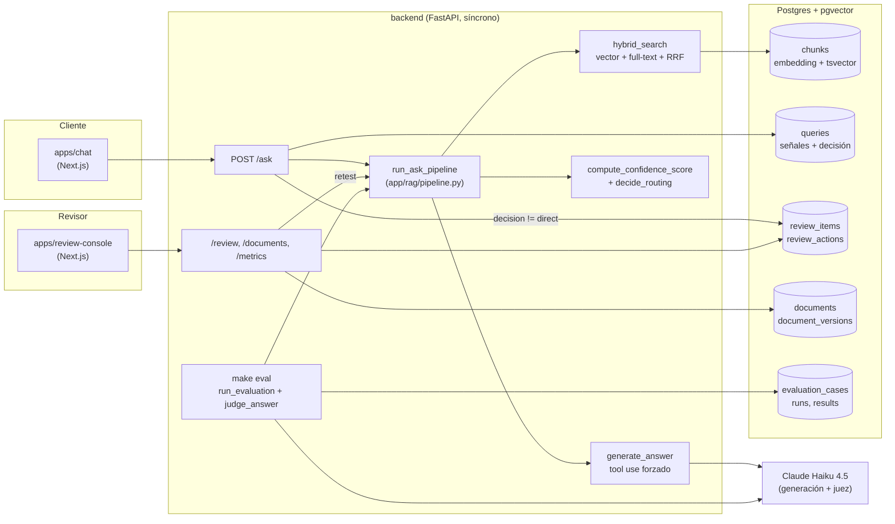

# Arquitectura

TecnoAndes Assist es un RAG con un sistema de confianza explícito y una
cola de revisión humana: en vez de contestar siempre con el mismo nivel de
certeza, cada respuesta se enruta según qué tan bien respaldada está.

## Vista general

## El pipeline de una pregunta

1. **Retrieval híbrido** (`app/rag/retrieval.py`): similitud vectorial
   (pgvector, embeddings E5 locales) y texto completo en español
   (`tsvector` + `unaccent`), cada uno como una consulta SQL simple e
   independiente, fusionados con **Reciprocal Rank Fusion** en Python
   puro — ver [ADR 0001](adr/0001-hybrid-retrieval-raw-sql-rrf.md).
2. **Generación** (`app/rag/generation.py`): Claude Haiku 4.5 con tool use
   **forzado** contra `submit_answer` (`strict: true`), no JSON en texto
   libre. El modelo reporta `support` (full/partial/none) comparando su
   propia respuesta contra el contexto que recibió.
3. **Confianza y enrutamiento** (`app/confidence/`): un puntaje 0–100
   ponderado sobre señales continuas, más dos compuertas duras
   (`needs_human`, cita inválida) que deciden antes de mirar el puntaje —
   ver [ADR 0002](adr/0002-confidence-scoring-hard-gates.md). Cuatro
   decisiones posibles: `direct`, `warn`, `review`, `escalate`.
4. **Persistencia y cola de revisión**: cada pregunta queda en `queries`
   (auditoría inmutable); si la decisión no es `direct`, se crea
   automáticamente un `review_item` — ver
   [ADR 0003](adr/0003-audit-trail-without-generic-log-table.md).

## Human-in-the-loop (Fase 3, consola en Fase 5)

Un caso en la cola se resuelve con una de seis acciones
(`app/review/actions.py`): aprobar, corregir, corregir + crear documento
nuevo, corregir + editar un documento existente, escalar, o descartar.
Editar un documento genera una nueva versión (`document_versions`) y
re-ingiere (chunking + embeddings) en la misma request. "Re-probar" corre
el mismo pipeline de nuevo sobre la base ya corregida, sin crear un caso
duplicado — comparación antes/después.

## Evaluación (Fase 6)

`make eval` corre un set de preguntas con respuesta esperada
(`eval/seed.jsonl`) contra el pipeline real y mide tres cosas: `recall@k`
contra los documentos esperados, si el enrutamiento acertó escalando (o
no) cada caso, y el veredicto de un LLM juez sobre si la respuesta
coincide con la esperada — ver
[ADR 0004](adr/0004-llm-as-judge-evaluation.md). Sirve para calibrar los
pesos y umbrales de confianza con datos, no a ojo.

## Auth

`/ask` es público (lo usa el chat). `/review`, `/documents` y `/metrics`
están protegidos con un token único compartido — una simplificación
deliberada para una demo con un solo revisor, documentada como no apta
para producción en [ADR 0005](adr/0005-single-token-auth-review-console.md).

## Esquema de base de datos

Ver [`CLAUDE.md`](../CLAUDE.md#esquema-de-base-de-datos-visión-completa-se-crea-de-forma-incremental)
para el detalle completo de cada tabla; el resumen:

| Área | Tablas |
|---|---|
| Conocimiento | `documents`, `document_versions`, `chunks` |
| Consultas y confianza | `queries`, `retrieved_chunks` |
| Revisión | `review_items`, `review_actions` |
| Evaluación | `evaluation_cases`, `evaluation_runs`, `evaluation_results` |

## Decisiones de diseño

Las decisiones puntuales (por qué SQL crudo para retrieval, por qué no
hay tabla de auditoría genérica, por qué compuertas duras separadas del
puntaje, etc.) están en [`CLAUDE.md`](../CLAUDE.md#decisiones-clave-con-su-trade-off)
con su trade-off explícito; las más significativas también como ADRs en
[`docs/adr/`](adr/).
